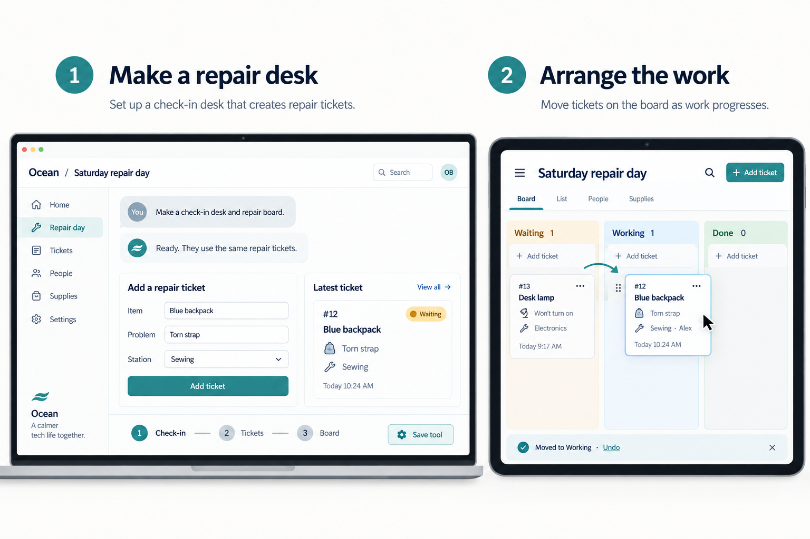
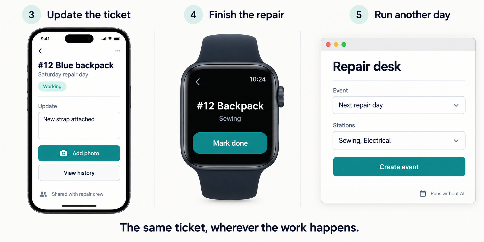

# Run a neighborhood repair day

Give volunteers a shared way to check in items, organize repairs, and record what happened.

*An illustrated Ocean scenario. These generated mockups explore the proposed experience.*

## Put together a repair desk

On your computer, create **Saturday repair day** and ask:

> Make a check-in desk and repair board.

Ocean connects a form, numbered repair tickets, a board, and a history of updates. Add your stations and invite the repair crew to work on this event.

A neighbor brings a blue backpack with a torn strap. Fill in the form and select **Add ticket**. Ticket **#12 Blue backpack** appears under **Waiting**.

## Arrange the work on your tablet

At the workbench, open the event on your tablet. Drag ticket #12 from **Waiting** to **Working**, then assign it to Alex at Sewing.

The form, board, and ticket detail all refer to the same ticket. A change in one appears in the others. Dragged the wrong card? Tap **Undo**.

You can change a station or assignment directly. If the crew wants a new view, ask, “Show each volunteer just their assigned repairs.” Ocean adds a view over the existing tickets.

## Record the repair wherever you are

On your phone, open #12, add “New strap attached,” and take a photo. The note and photo become part of that ticket's history.

After checking the repair, tap **Mark done** on your watch. The same ticket moves to **Done** on the tablet and computer. The watch offers one useful action; the larger screens keep the details close by.

The crew can update this event's tickets because you shared that access with them. Your other objects stay private.

## Run another day with the same tool

Select **Save tool** and name it **Repair desk**. For the next event, choose the stations and select **Create event**. You get a fresh set of tickets using the same form and board; Saturday's records remain intact.

Creating tickets, assigning people, adding notes, and moving work along all run without AI. The agent helps when you want to change what the tool can do. The crew can use it all day without chatting to it.

[Explore the dinner planner example](weekly-dinners.md) · [Read the Ocean vision](../VISION.md)
