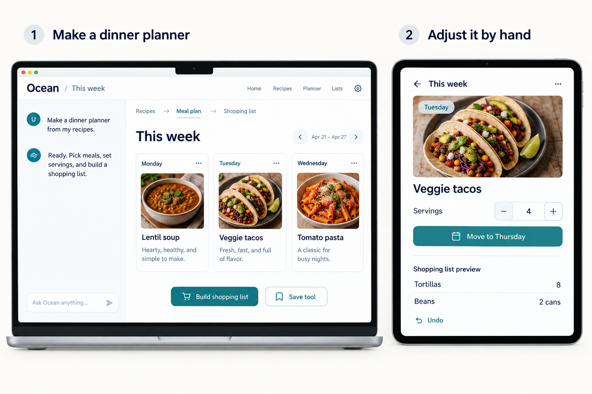
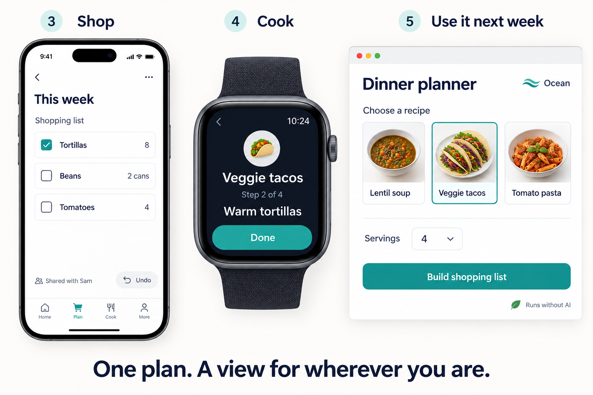

# Plan dinners for the week

Pick meals, tweak the portions, and take the shopping list with you.

*An illustrated Ocean scenario. These generated mockups explore the proposed experience.*

## Make a tool from a request

On your computer, you open your saved recipes and ask:

> Make a dinner planner from my recipes.

Ocean connects a recipe picker, a weekly calendar, portion calculations, and a shared checklist. You get a working planner with buttons and editable meals. Choose lentil soup, veggie tacos, and tomato pasta, then select **Build shopping list**.

The recipes stay yours. The planner uses those same recipe objects, so you can open and edit them from either the plan or your collection.

## Change your mind on the tablet

Two more people are coming. Open **This week** on your tablet and increase the taco servings from two to four. The linked list now calls for eight tortillas and two cans of beans. Tap **Move to Thursday** to reschedule dinner. **Undo** brings it back.

These are ordinary controls. Changing portions runs the saved calculation; moving dinner changes its date.

## Shop on your phone and cook with your watch

At the store, open the same list on your phone and check off tortillas. Sam, who you've given permission to edit the list, sees the checkmark too.

At home, open the tacos from the plan. Your tablet shows the full recipe; your watch shows just the current step. Tap **Done** on your watch and the tablet advances with you. The recipe, meal plan, list, and cooking progress stay connected across devices.

## Use it again next week

Select **Save tool** and call it **Dinner planner**. Next week, pick recipes, set servings, and build a fresh list. Your earlier plans remain available.

Picking meals, calculating quantities, checking items, and advancing steps all work without AI. If you later ask, “Add a way to use up leftovers,” the agent can extend the tool. You can keep using the controls you already know.

[Explore the repair day example](repair-day.md) · [Read the Ocean vision](../VISION.md)
